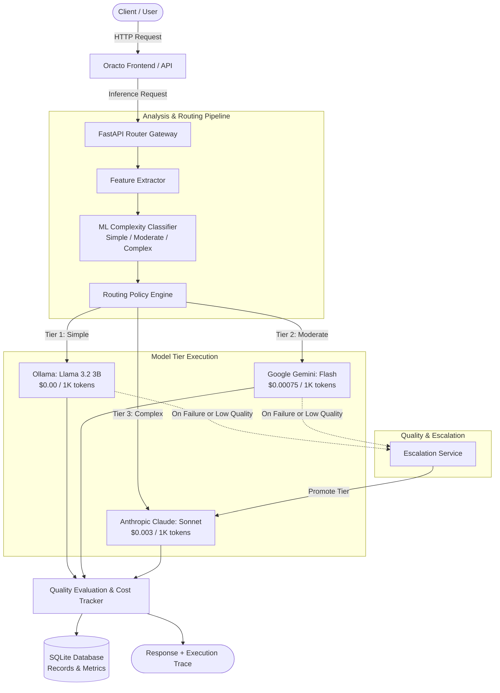

# Oracto ⚡

<p align="center">
  <strong>Intelligent, Multi-Tier LLM Routing & Cost Optimization Gateway</strong>
</p>

<p align="center">
  
  
  
  
  
  
  
</p>

---

## 📖 Overview

**Oracto** is an intelligent AI gateway and model router designed to slash LLM API costs by up to **80%** without compromising response quality. 

Instead of sending every query to expensive frontier models, Oracto uses a real-time **machine learning complexity classifier** to analyze incoming prompts and dynamically route them to the most cost-effective model tier:

* **Tier 1 (Free / Local)**: Ollama (`llama3.2:3b`) for straightforward queries.
* **Tier 2 (Cost-Effective / Fast)**: Google Gemini (`gemini-3.8-flash`) for moderate reasoning.
* **Tier 3 (Frontier Benchmark)**: Anthropic Claude (`claude-sonnet-4-6`) for complex logic and coding.

If a lower-tier model encounters an error or fails quality criteria, Oracto's **automated escalation engine** seamlessly promotes the query to higher-tier models while recording execution traces.

---

## 🚀 Key Features

* **🧠 ML Prompt Complexity Classification**: A fast Logistic Regression pipeline with feature extraction (word count, code syntax markers, reasoning keywords, constraints, and question structure) that evaluates prompts in milliseconds.
* **🔀 Dynamic Multi-Tier Routing**: Automatically selects the cheapest model capable of handling the request complexity tier, respecting configured routing thresholds.
* **🛡️ Self-Healing Escalation & Fallbacks**: Automatically falls back or escalates across providers when latency budgets, timeouts, or quality thresholds are breached.
* **💰 Real-Time Cost & Baseline Savings Tracker**: Accurately computes input/output token costs against a 100% frontier model baseline, visualizing net dollars and percentages saved.
* **🧪 Interactive Playground**: Test prompts live in the web console, inspect token usage, latency breakdowns, and view the exact step-by-step execution trace.
* **📊 Comprehensive Observability Dashboard**: Built-in dashboards for tier distribution, provider uptime, escalation rates, quality scores, and historic query auditing.
* **🐳 Production-Ready Containerization**: Fully reproducible single-command deployment via Docker Compose with health checks and persistent volume storage.

---

## 🏛️ System Architecture



---

## 🎯 Model Tier Matrix

| Tier | Tier Level | Target Provider | Default Model | Input Cost / 1K | Output Cost / 1K | Recommended For |
|---|:---:|---|---|:---:|:---:|---|
| **Tier 1** | Simple | **Ollama** | `llama3.2:3b` | **$0.00** | **$0.00** | Greetings, facts, short summaries, classification |
| **Tier 2** | Moderate | **Google Gemini** | `gemini-3.8-flash` | **$0.00075** | **$0.00375** | Content writing, moderate analysis, data formatting |
| **Tier 3** | Complex | **Anthropic** | `claude-sonnet-4-6` | **$0.00300** | **$0.01500** | Complex coding, multi-step math, architectural design |

*Pricing and models can be customized in [`backend/app/core/models.yaml`](backend/app/core/models.yaml).*

---

## ⚡ Quick Start with Docker (Recommended)

### 1. Prerequisites
- [Docker Desktop](https://www.docker.com/products/docker-desktop/) installed and running.

### 2. Configure Environment
Copy `.env.example` to `.env`:
```bash
cp .env.example .env
```
Add your API keys to `.env`:
```env
GEMINI_API_KEY=your_gemini_api_key_here
ANTHROPIC_API_KEY=your_anthropic_api_key_here
OLLAMA_BASE_URL=http://host.docker.internal:11434
VITE_API_BASE_URL=http://localhost:8000/api/v1
```
*(Leave any key blank if you do not plan to test that specific provider).*

### 3. Build and Start
```bash
docker compose build
docker compose up
```

### 4. Access the Services
* **Frontend Web Application**: [http://localhost](http://localhost)
* **Backend API Base**: [http://localhost:8000](http://localhost:8000)
* **Interactive Swagger API Docs**: [http://localhost:8000/docs](http://localhost:8000/docs)
* **API Health Check**: [http://localhost:8000/health](http://localhost:8000/health)

To stop the containers:
```bash
docker compose down
```
*(The SQLite database persists in the Docker volume `oracto_data` across container restarts).*

---

## 🛠️ Local Development Setup

If you prefer to run frontend and backend locally without Docker:

### 1. Backend Setup

```bash
cd backend

# Create & activate virtual environment
python -m venv .venv

# Windows:
.\.venv\Scripts\Activate.ps1
# macOS / Linux:
source .venv/bin/activate

# Install dependencies
pip install -r requirements.txt
pip install -r requirements-dev.txt

# Start the API server
uvicorn main:app --reload --host 0.0.0.0 --port 8000
```

### 2. Frontend Setup

```bash
cd frontend-app

# Install dependencies
npm install

# Start Vite dev server
npm run dev
```

Visit [http://localhost:5173](http://localhost:5173) in your browser.

---

## 🧪 Running Tests

The test suite includes **66 comprehensive unit and integration tests** covering prompt feature extraction, ML complexity scoring, routing policies, provider fallback chains, cost calculations, and API endpoints.

```bash
cd backend
pytest -v
```

To run frontend production build validation and lint checks:
```bash
cd frontend-app
npm run build
```

---

## 📂 Repository Structure

```
.
├── backend/                        # FastAPI Backend Application
│   ├── app/
│   │   ├── api/                    # Route handlers & endpoints
│   │   ├── core/                   # Configuration & models.yaml registry
│   │   ├── database/               # SQLAlchemy engine and session
│   │   ├── models/                 # Database ORM schema definitions
│   │   ├── schemas/                # Pydantic request/response models
│   │   └── services/               # Routing, ML complexity, & cost services
│   ├── tests/                      # 66 automated pytest test suites
│   ├── Dockerfile                  # Backend Docker image specification
│   ├── main.py                     # ASGI FastAPI entrypoint
│   └── requirements.txt            # Python dependencies
│
├── frontend-app/                   # React 19 + TypeScript + Vite Frontend
│   ├── src/
│   │   ├── components/             # Reusable UI component library
│   │   ├── layouts/                # MainLayout and navigation sidebar
│   │   ├── pages/                  # Dashboard, Playground, Analytics, Routing
│   │   ├── services/               # API clients
│   │   └── types/                  # TypeScript data interfaces
│   ├── Dockerfile                  # Multi-stage production build (Node + Nginx)
│   ├── nginx.conf                  # Nginx proxy & SPA router config
│   └── package.json                # Frontend dependencies
│
├── .env.example                    # Environment variable template
├── .gitignore                      # Git ignore rules for Python, Node, & DBs
├── docker-compose.yml              # Multi-container orchestration
└── README.md                       # Main project documentation
```

---

## 📡 REST API Reference

| Endpoint | Method | Description |
|---|:---:|---|
| `/health` | `GET` | Service status and provider health check |
| `/api/v1/completions` | `POST` | Send prompt for ML classification & smart routing |
| `/api/v1/models` | `GET` | List registered models, tier assignments, and costs |
| `/api/v1/routing-config` | `GET` | Retrieve active routing thresholds and rules |
| `/api/v1/routing-config` | `PUT` | Update routing minimum tiers dynamically |
| `/api/v1/requests` | `GET` | List past requests, tier selections, and latencies |
| `/api/v1/requests/{id}` | `GET` | Retrieve full execution trace and escalation log |
| `/api/v1/analytics/stats` | `GET` | Overview metrics: cost saved, queries routed, SLA |
| `/api/v1/analytics/cost` | `GET` | Detailed token cost breakdowns and savings |
| `/api/v1/classifier/report` | `GET` | Precision, recall, and accuracy metrics for the ML model |
| `/api/v1/classifier/retrain` | `POST` | Trigger retraining of prompt complexity classifier |

---

## 🤝 Contributing

1. Fork the repository.
2. Create your feature branch (`git checkout -b feature/amazing-feature`).
3. Commit your changes (`git commit -m "Add amazing feature"`).
4. Run tests to ensure all 66 tests pass (`pytest` and `npm run build`).
5. Push to the branch (`git push origin feature/amazing-feature`).
6. Open a Pull Request.

---

## 📄 License

This project is open-source and licensed under the [MIT License](LICENSE).
